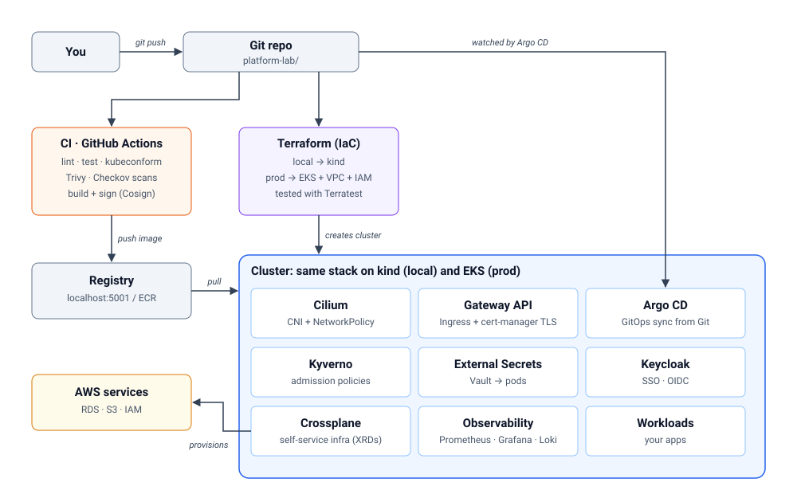
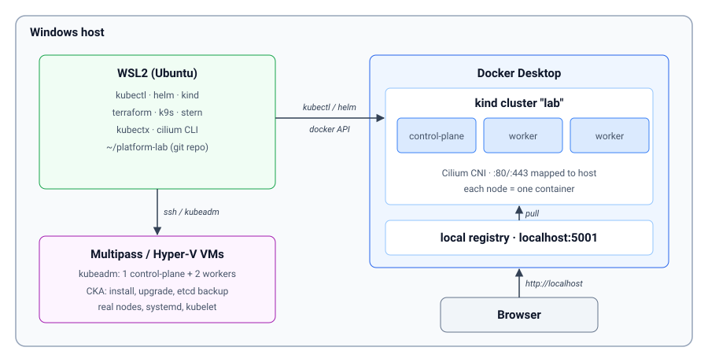
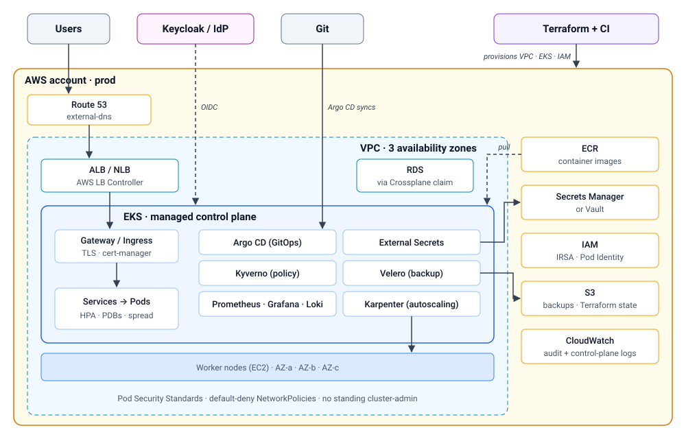

# Kubernetes Lab Reference: Local and Production

A companion to [platform_first.md](platform_first.md).

**Core rule:** keep clusters disposable. Install everything from Git with Terraform, Helm and Argo CD, so the local lab and production run the same stack on different clusters.

## What to use

| Where | Tool | Why |
|---|---|---|
| Local lab + CI | **kind** | Kubernetes nodes as Docker containers. Multi-node, recreated in seconds. Kubernetes uses it for its own CI. |
| CKA practice | **kubeadm** on 2–3 VMs | The upstream installer. You do cluster setup, upgrades and etcd backup/restore yourself. |
| Production (cloud) | **EKS** (or GKE/AKS) | What most companies run. The provider runs the control plane and etcd. Provisioned with Terraform. |
| Production (on-prem) | **kubeadm** via **Kubespray** | Kubespray is Ansible that runs kubeadm across many nodes, with HA and upgrades. |

## How it fits together



---

## Local lab



### Tools

| Tool | Purpose |
|---|---|
| Docker Desktop (WSL integration on) | Runs the kind nodes |
| `kind` | Creates and deletes clusters |
| `kubectl` | Talks to the cluster |
| `helm` | Installs charts (Cilium, Argo CD, and so on) |
| `terraform` | Infrastructure as code |
| `k9s` | Terminal UI. Optional, but it saves a lot of typing |

### Install (inside WSL)

```bash
mkdir -p ~/.local/bin   # ensure it's on PATH
curl -Lo ~/.local/bin/kind https://kind.sigs.k8s.io/dl/latest/kind-linux-amd64 && chmod +x ~/.local/bin/kind
curl -Lo ~/.local/bin/kubectl "https://dl.k8s.io/release/$(curl -Ls https://dl.k8s.io/release/stable.txt)/bin/linux/amd64/kubectl" && chmod +x ~/.local/bin/kubectl
curl -fsSL https://raw.githubusercontent.com/helm/helm/main/scripts/get-helm-3 | bash
```

### Cluster config: `platform-lab/kind.yaml`

```yaml
kind: Cluster
apiVersion: kind.x-k8s.io/v1alpha4
name: lab
networking:
  disableDefaultCNI: true   # install Cilium instead (enforces NetworkPolicy)
  kubeProxyMode: none       # Cilium replaces kube-proxy
nodes:
  - role: control-plane
    extraPortMappings:
      - { containerPort: 80, hostPort: 80 }
      - { containerPort: 443, hostPort: 443 }
  - role: worker
  - role: worker
```

### Bootstrap

```bash
kind create cluster --config platform-lab/kind.yaml
helm repo add cilium https://helm.cilium.io && helm repo update
helm install cilium cilium/cilium -n kube-system \
  --set kubeProxyReplacement=true \
  --set k8sServiceHost=lab-control-plane --set k8sServicePort=6443
kubectl get nodes -w          # NotReady until Cilium is up, which is expected
```

Reset: `kind delete cluster --name lab`, then run the bootstrap again.

### kind in CI

Use the `helm/kind-action` GitHub Action to start a throwaway cluster in a pipeline and run your Helm installs and tests against it.

---

## Production (EKS)



### Checklist

- [ ] **HA:** managed control plane, workers across 3 availability zones
- [ ] **IaC:** Terraform for the VPC, EKS, IAM and node groups, with state in S3
- [ ] **GitOps:** Argo CD. No manual `kubectl apply`
- [ ] **Autoscaling:** Karpenter for nodes, HPA for pods
- [ ] **Networking:** Gateway/Ingress, cert-manager, external-dns, default-deny NetworkPolicies
- [ ] **Identity:** SSO (OIDC), IRSA or Pod Identity, no standing cluster-admin
- [ ] **Security:** Kyverno, Pod Security Standards, signed and scanned images, audit logs
- [ ] **Secrets:** External Secrets, backed by Secrets Manager or Vault
- [ ] **Observability:** Prometheus, Grafana and Loki, with alerts tied to SLOs
- [ ] **Backup and DR:** Velero plus a *tested* restore
- [ ] **Upgrades:** control plane first, then nodes. Check for deprecated APIs before each upgrade

**Cost tip:** build everything on kind first. Create EKS only to test the Terraform milestone, then `terraform destroy` the same day.
